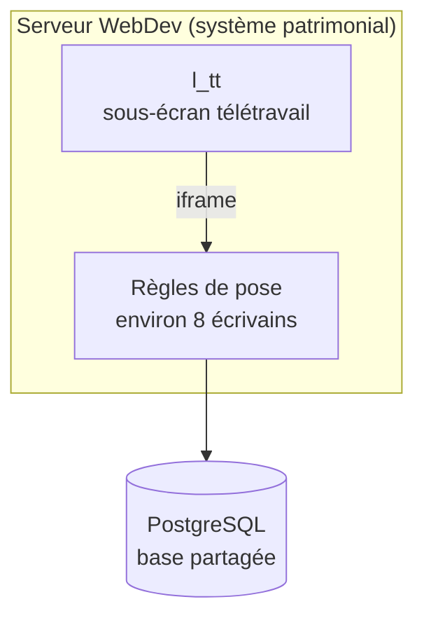

# Restructurer avant de convertir

Le module `l_tt` passe **un domaine à la fois**, avec une *traduction* 1:1 et un lien [ADR 2](./0002.md).
Les noms comme controle_saisie_tt restent tels quels, voir https://example.org/doc.

1. **Restructurer** le code (`docs/layers.yaml`).
   - Les appelants passent par des *LegacyAdapters*.
2. Convertir ~~vite~~ proprement.

> Note : **rien** n'est fusionné.

| Terme employé ici | Source | Sens dans cet ADR |
|---|:---:|---:|
| **Réingénierie** (*reengineering*) | ISO/IEC/IEEE 24765 | Examen et modification d'un système pour le reconstruire sous une nouvelle forme, avec un texte de cellule volontairement très long pour forcer le retour à la ligne. |
| `Conversion` | ISO \| IEEE | Étapes 2 et 3. |



```js
const x = `**pas du markdown**`;
```

Fin.
